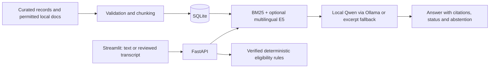

# Multilingual Knowledge Assistant for Government Schemes Using Cross-Lingual RAG

Local-first academic application for discovering curator-supplied Central and State welfare schemes, asking questions in English, Bengali or Hindi, checking potential eligibility, and viewing traceable source excerpts. It does not scrape myScheme, invent scheme records, or require paid APIs. The supplied PowerPoint's 10+ language / 10,000-question benchmark is a future target, not an implemented result.

## What works

- FastAPI v1 API and Streamlit UI, served separately.
- Curator imports in JSON/CSV, plus permitted local PDF, TXT, Markdown and HTML documents.
- SQLite scheme, document, chunk and feedback storage; idempotent content-hash chunking and ingestion report.
- BM25 retrieval with Unicode tokenization and metadata filters. Optional local multilingual-e5-large dense retrieval is configurable.
- Evidence excerpts, real stored source URLs/statuses, localized abstention when evidence is absent, and local Ollama Qwen3 grounded answer generation when installed.
- Streaming chat at `/api/v1/chat/stream`: answer fragments appear in the Streamlit UI as Ollama generates them; citations and warnings arrive with the final event. The existing `/api/v1/chat` JSON endpoint remains available.
- Deterministic eligibility checks for verified structured rules; unknown or unverified rules remain unknown.
- Audio upload API and UI with editable transcription step; optional local faster-whisper. Text remains available.
- Evaluation runner for retrieval metrics; no scores are claimed without a verified dataset.

Not implemented: myScheme crawler (prohibited absent authorization), populated authentic catalog, persistent FAISS vectors/embedding reuse, IndicTrans2 translation, cross-encoder reranker, microphone capture widget, TTS, OCR, PostgreSQL/pgvector, MLflow, 10-language/10,000-QA benchmark, genuine model or speech benchmark. Audio transcription with Whisper is provisional and not benchmarked.

## Architecture and requirements

The full PPT checklist and trade-offs are in [docs/requirements-checklist.md](docs/requirements-checklist.md). Architecture and query flow: [docs/architecture.md](docs/architecture.md). Curation and statuses: [docs/data_curation.md](docs/data_curation.md). Model access/limits: [docs/model_selection.md](docs/model_selection.md). Evaluation: [docs/evaluation.md](docs/evaluation.md).



## Setup

Python 3.10+ is required. From repository root:

```bash
python3 -m venv .venv
source .venv/bin/activate
pip install -e '.[ui,dev]'
cp .env.example .env
```

The interface can run without model weights or API keys. First launch creates the local SQLite schema. Set paths and model choices with `GSA_*` environment variables in your shell (the sample `.env` is documentation; automatic dotenv loading is not enabled).

Application and CLI logging defaults to `DEBUG` and is written to the launching terminal so startup, API requests, retrieval, generation, eligibility, ingestion, storage, and speech steps can be traced. Set `GSA_LOG_LEVEL=INFO` (or `WARNING`, `ERROR`) to reduce verbosity. Question text, profile values, and speech transcripts are not logged.

### Optional local AI models

- **LLM:** Install Ollama using its current official instructions, then explicitly download Qwen3-4B (default runtime ID `qwen3:4b`) and start Ollama. Verify the current checkpoint license/access and hardware requirements. No model download happens at app startup. Without it, the app returns retrieved excerpts with citations.
- **Embeddings:** `pip install -e '.[models]'`, explicitly download/cache `intfloat/multilingual-e5-large`, set `GSA_EMBEDDINGS_ENABLED=true`. Check its model card/license; expect multi-GB disk/RAM needs. BM25 works independently. Dense scoring is on-demand; persistent FAISS is future work.
- **Speech:** `pip install -e '.[models]'`, set `GSA_STT_PROVIDER=faster-whisper` and optionally `GSA_STT_MODEL=large-v3-turbo`. Cache model weights before offline use. Model access, size and performance depend on runtime and hardware. Audio is sent only to the local API and is not retained. The UI lets users edit the transcript before submission. No genuine ASR quality measurements are included.
- **Translation/reranking:** IndicTrans2 and multilingual cross-encoder are not enabled; direct multilingual retrieval is the primary path.

### Import and ingest

Curated imports use `data/templates/schemes.json` or `.csv`. Keep unknowns null; retain provenance. Import success does not mean verified.

```bash
python scripts/validate_data.py path/to/schemes.json
python scripts/import_schemes.py path/to/schemes.json
python scripts/ingest_documents.py stable-scheme-id path/to/permitted-source.pdf --title 'Official guidance' --url https://official.example/source
python scripts/inspect_index.py
```

Scanned PDFs require a permitted local OCR step; no OCR is claimed. Supplementary department sources stay identified as their own sources. myScheme collection is enabled only for users with its written authorization; follow the authorization's scope and request limits.

### Automated scheme collection

With written myScheme authorization, the collector retrieves central schemes plus state-specific schemes for West Bengal, Bihar, and Jharkhand. It does not apply an age filter; it preserves each scheme's age and other eligibility text. It writes the structured export to `data/curated/myscheme_schemes.json`, caches raw responses in `data/raw/myscheme/`, saves searchable text in `data/processed/myscheme/`, and indexes the text in SQLite. Records remain `unverified` until checked against their implementing departments. Eligibility text is preserved, but automatic eligibility assessment remains unavailable unless a curator verifies and structures the rules.

```bash
python scripts/gather_data.py
```

Use `--refresh` to fetch current records instead of reusing the local response cache. The default target is three states; replace them with exactly three names using `--states STATE1 STATE2 STATE3`.

### Run everything with one command

After the one-time environment setup below, launch data collection (on first run), the API, and the Streamlit UI with:

```bash
python scripts/run_project.py
```

The UI is served at `http://localhost:8501`; API docs are at `http://localhost:8000/docs`. Use Ctrl+C to stop both services. Add `--refresh-data` to refresh the collection before startup.

### Run

In two terminals at the repository root:

```bash
uvicorn backend.main:app --reload --log-level debug
streamlit run frontend/app.py
```

API docs: `http://localhost:8000/docs`; health: `/health`. Configure frontend API with `GSA_API_URL`. Supported codes `en`, `bn`, `hi`; language support in model outputs is not equal or independently validated. Personal details are not saved by default. Do not enter sensitive identifiers.

## Tests and evaluation

```bash
pip install -e '.[dev]'
pytest
python scripts/evaluate.py --dataset data/evaluation/qa.json --k 5
```

Tests use deterministic/unit and API paths; they do not download weights. Evaluation set is empty by default. See [docs/evaluation.md](docs/evaluation.md) for required annotations and metrics. Do not report the PPT's proposed scale or quality outcomes as achieved.

## Project structure

```text
backend/                 FastAPI application and versioned routes
frontend/                Streamlit UI and API service layer
src/government_assistant/ configuration, schemas, curation, retrieval, eligibility, generation, speech
data/templates/          curator import schemas; no production records
data/evaluation/         empty manual-evaluation dataset
scripts/                 import, validation, ingestion, inspection and evaluation commands
docs/                    requirements, architecture, curation, model and evaluation notes
tests/                   unit and API tests
storage/                 local SQLite data; ignored by Git
```

See [docs/troubleshooting.md](docs/troubleshooting.md). Future work includes audio recording, OCR, persistent FAISS with embedding cache/manifests, verified scheme corpus, language-specific UI copy, IndicTrans2, reranking, privacy-preserving local experiment tracking, and a manually checked multilingual benchmark.
