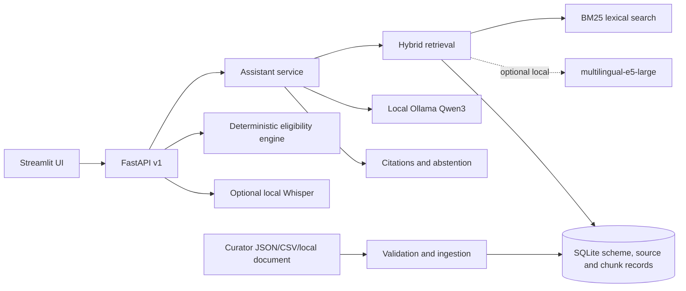
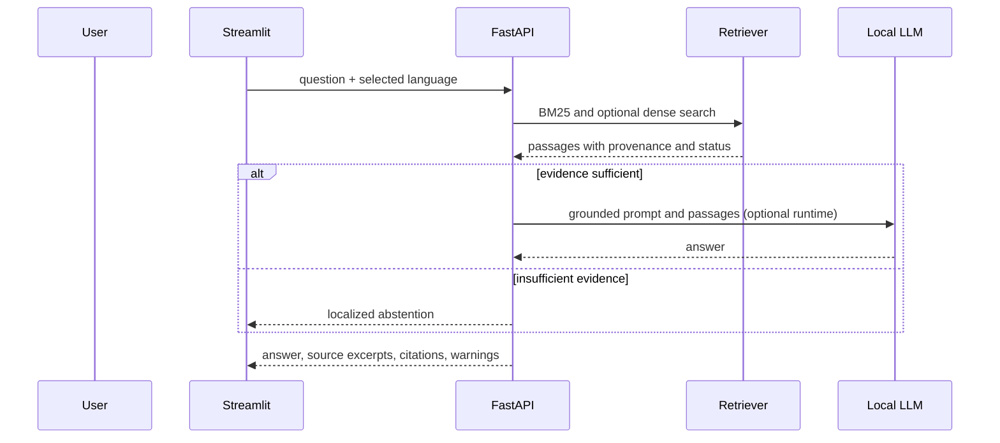

# Architecture

The Streamlit question flow uses `POST /api/v1/chat/stream` and Server-Sent Events. FastAPI sends progress events for catalog search, ranking method, source review, prompt preparation, and generation. It sends the ranked source excerpts before streaming Ollama response fragments as token events. A final event carries the complete answer, citations, evidence status, warnings, provider, and timing. If evidence is insufficient, the endpoint streams a localized abstention. If Ollama is unavailable, it streams the retrieved excerpt fallback. The non-streaming `POST /api/v1/chat` endpoint remains available for clients that want one JSON response. Progress and retrieved evidence are shown; private model reasoning is not exposed.

SQLite is the initial local store. BM25 is always available. Dense embeddings currently use on-demand local encoding, rather than persistent FAISS. Translation, reranking, PostgreSQL/pgvector, and experiment tracking are extension points, not implemented features.
